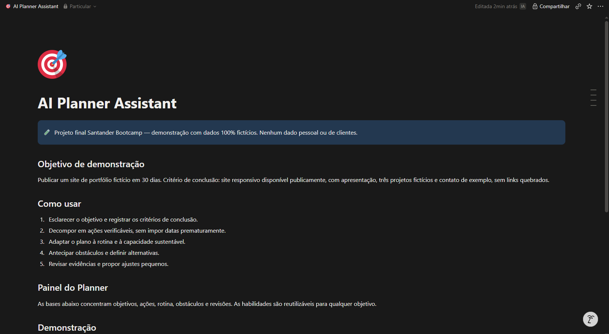
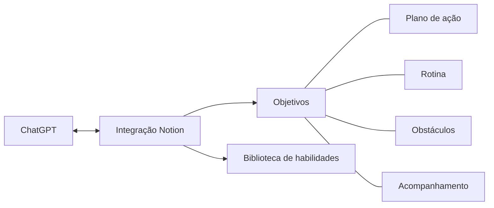
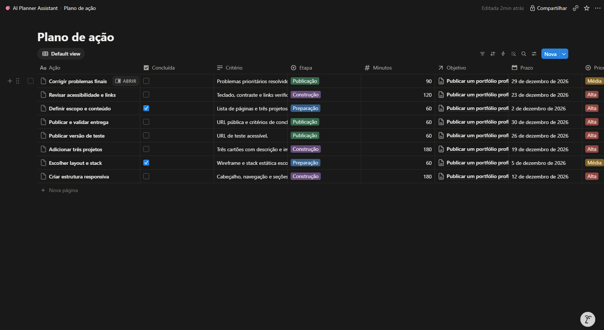
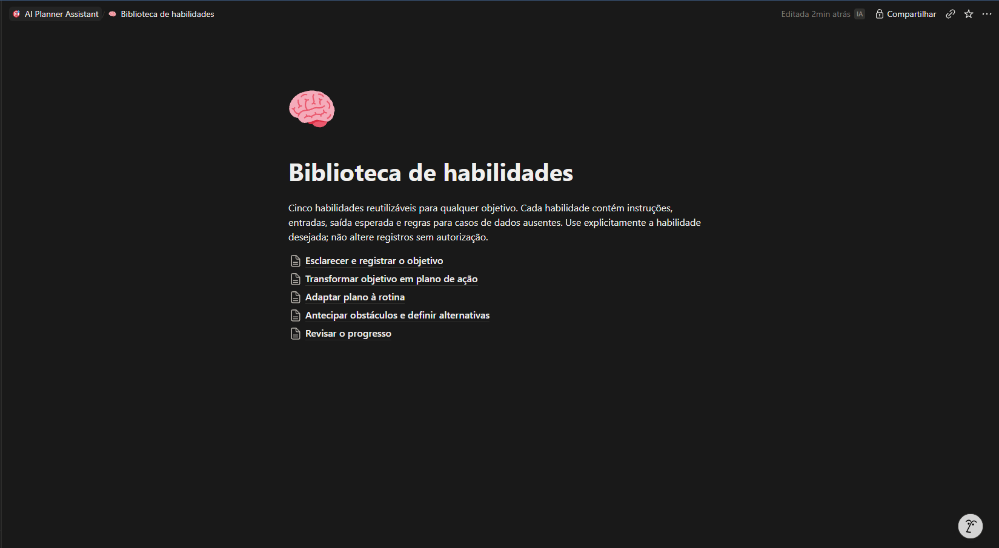
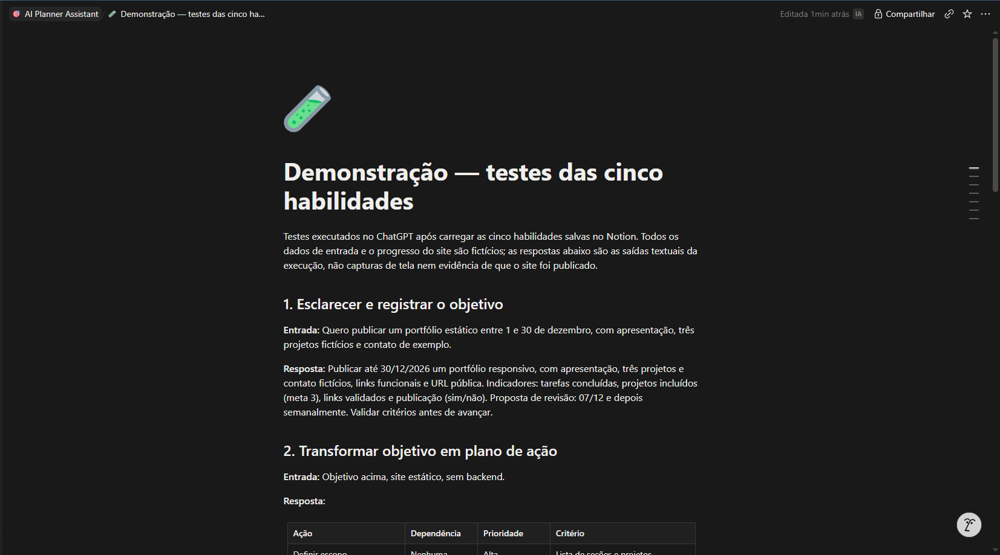
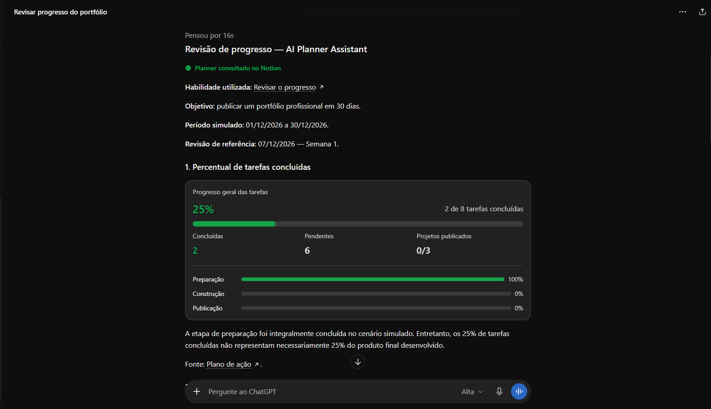

# AI Planner Assistant

> Assistente de planejamento com inteligência artificial, integrado ao Notion e ao ChatGPT, para transformar objetivos em ações e acompanhar sua execução.

Projeto final do **Santander Bootcamp — Crie seu Assistente de IA**, realizado na plataforma DIO. Todos os dados do estudo de caso são fictícios.



## 1. Problema e proposta

Transformar um objetivo em um plano viável exige definir o resultado esperado, organizar tarefas, avaliar o tempo disponível, prever obstáculos e revisar o progresso. Essas informações muitas vezes ficam dispersas em anotações e conversas, dificultando a continuidade do planejamento.

O AI Planner Assistant reúne essas informações em um único Planner no Notion e utiliza cinco habilidades reutilizáveis para orientar a IA em cada etapa. Seu diferencial é combinar um método de planejamento independente do objetivo com a consulta direta às bases do Notion pelo ChatGPT, evitando a necessidade de copiar os mesmos prompts e dados a cada conversa.

A solução é no-code: não utiliza backend próprio, API customizada ou modelo de IA treinado especificamente para o projeto.

## 2. Ferramentas e recursos utilizados

| Ferramenta / recurso | Aplicação no projeto | Motivo da escolha |
| --- | --- | --- |
| Notion | Página central, bases de dados, registros e biblioteca de habilidades | Centralizar informações estruturadas e permitir a atualização do plano. |
| Relações do Notion | Vincular ações, rotina, obstáculos e revisões aos objetivos | Reutilizar as bases para diferentes objetivos sem duplicar registros. |
| Propriedades do Notion | Checkbox, seleção, data, texto, número e título | Organizar ações, prazos, estimativas, critérios e evidências. |
| Notion Skills | Cinco habilidades com descrições e instruções reutilizáveis | Padronizar o método aplicado pela IA. |
| ChatGPT | Executar as habilidades, analisar registros e sugerir ajustes | Interpretar o contexto e gerar recomendações estruturadas. |
| Integração Notion + ChatGPT | Consulta ao Planner e às habilidades diretamente na conversa | Evitar transferência manual de informações entre ferramentas. |
| Markdown e GitHub | Documentação e evidências do projeto | Permitir leitura pública e reprodução do método. |

## 3. Método de planejamento

1. Esclarecer o objetivo e estabelecer critérios de conclusão.
2. Decompor o objetivo em etapas e ações verificáveis.
3. Adaptar o plano à rotina e à capacidade sustentável.
4. Antecipar obstáculos e definir alternativas.
5. Revisar as evidências de progresso e recomendar ajustes pontuais.

As etapas são sequenciais na criação inicial do plano, mas podem ser retomadas durante a execução. Uma revisão pode indicar a necessidade de ajustar a rotina ou reavaliar riscos, sem reconstruir todo o planejamento.

### Instruções aplicadas à IA

- Diferenciar fatos, hipóteses e recomendações.
- Não inventar prazos, disponibilidade, evidências ou tarefas concluídas.
- Estabelecer critérios observáveis de conclusão e dependências entre ações.
- Não atribuir horários antes de conhecer a rotina; preservar descanso e compromissos.
- Não considerar horários condicionais como garantidos.
- Propor alternativas viáveis e ajustes pequenos, com justificativa.
- Consultar o objetivo correto e o esquema da base antes de gravar informações.
- Apresentar propostas primeiro e alterar registros somente quando autorizado; preservar informações existentes e verificar a gravação.
- Quando faltarem dados essenciais, solicitar esclarecimentos; sem acesso ao Notion, retornar uma saída copiável.
- Não expor informações pessoais ou confidenciais.

## 4. Estrutura do Planner

O Planner contém cinco bases de dados relacionadas e uma biblioteca de habilidades. A base **Objetivos** é a referência central. Cada registro nas quatro bases complementares possui uma relação com o objetivo correspondente.



| Base de dados | Propriedades | Finalidade |
| --- | --- | --- |
| Objetivos | Objetivo, Critério de conclusão, Prazo, Revisão, Situação | Registrar o resultado desejado e acompanhar sua situação. |
| Plano de ação | Ação, Objetivo (relação), Etapa, Concluída, Prazo, Minutos, Prioridade, Critério | Organizar e acompanhar ações verificáveis. |
| Rotina | Janela, Objetivo (relação), Dia, Minutos, Condição, Horário | Mapear a disponibilidade e distinguir períodos favoráveis e condicionais. |
| Obstáculos | Obstáculo, Objetivo (relação), Impacto, Gatilho, Alternativa | Registrar riscos antecipados e respostas possíveis. |
| Acompanhamento | Revisão, Objetivo (relação), Data, Indicador, Evidência, Ajuste | Documentar revisões, progresso e recomendações. |

No estudo de caso, foram criados 1 objetivo, 8 ações, 3 janelas de disponibilidade, 3 obstáculos e 1 revisão simulada.



O progresso é calculado pelo assistente a partir da proporção de ações concluídas. O Planner não implementa um rollup automático de progresso nesta versão; o registro de revisão contém o indicador da simulação.

## 5. Habilidades do assistente

As habilidades são páginas do Notion com instruções, descrição de uso, entradas, procedimento, saída esperada e cuidados de registro. Elas foram criadas e habilitadas para consulta pelo assistente.

| Habilidade | Descrição e funcionamento |
| --- | --- |
| [Esclarecer e registrar o objetivo](skills/clarify-goal.md) | Converte uma intenção em objetivo específico, critérios de conclusão, indicadores e proposta de revisão. |
| [Transformar objetivo em plano de ação](skills/action-plan.md) | Decompõe um objetivo validado em etapas, tarefas, prioridades, dependências e critérios verificáveis, sem impor horários. |
| [Adaptar plano à rotina](skills/routine-planner.md) | Calcula a capacidade disponível, diferencia janelas favoráveis e condicionais e distribui ações de maneira sustentável. |
| [Antecipar obstáculos e definir alternativas](skills/risk-analysis.md) | Identifica riscos, classifica o impacto e define gatilhos observáveis e alternativas no formato se–então. |
| [Revisar o progresso](skills/progress-review.md) | Analisa indicadores e evidências, calcula tarefas concluídas e recomenda próximos passos e ajustes pontuais. |

Os arquivos acima reproduzem as instruções das habilidades em Markdown, sem identificadores de páginas privadas, para facilitar sua reutilização.



## 6. Demonstração prática

### Estudo de caso fictício

**Objetivo:** publicar um site de portfólio profissional em 30 dias, de 1 a 30 de dezembro de 2026.

**Critério de conclusão:** site estático e responsivo, disponível publicamente, com apresentação, três projetos fictícios, contato de exemplo e links testados. Não é necessário desenvolver o site para este desafio; o objeto da entrega é o assistente e seu planejamento.

### Testes das cinco habilidades

| Habilidade | Entrada do teste | Saída obtida |
| --- | --- | --- |
| Esclarecer objetivo | Publicar um portfólio estático em dezembro, com três projetos e contato fictícios. | Objetivo verificável, critérios, indicadores de tarefas, projetos e URL pública; revisão semanal proposta. |
| Plano de ação | Objetivo esclarecido, escopo estático, sem backend. | Oito ações ordenadas, com dependências, prioridades e critérios de conclusão. |
| Adaptar à rotina | Terça 19h–20h e sábado 9h–12h favoráveis; quinta 19h–20h condicional. | 4h favoráveis por semana, 1h condicional e proposta sustentável de 3–4h; quinta reservada a imprevistos. |
| Antecipar obstáculos | Prazo de 30 dias, rotina definida e hospedagem estática. | Três riscos: perda de disponibilidade, escopo excessivo e falha na hospedagem, com gatilhos e alternativas. |
| Revisar progresso | Revisão simulada de 07/12: 2 de 8 ações concluídas, sem URL pública. | 25% das ações concluídas; próxima ação é criar a estrutura responsiva; preservar escopo e revisar prazos se necessário. |

Também foi considerado um caso com informações insuficientes: diante de um objetivo vago de melhorar a carreira, a habilidade de esclarecimento solicita um resultado observável e informações sobre prazo antes de definir tarefas.



### Plano de ação do exemplo

| Ação | Etapa | Prazo simulado | Esforço | Situação simulada |
| --- | --- | --- | ---: | --- |
| Definir escopo e conteúdo | Preparação | 02/12 | 1h | Concluída |
| Escolher layout e stack | Preparação | 05/12 | 1h | Concluída |
| Criar estrutura responsiva | Construção | 12/12 | 3h | Pendente |
| Adicionar três projetos | Construção | 19/12 | 3h | Pendente |
| Revisar acessibilidade e links | Construção | 23/12 | 2h | Pendente |
| Publicar versão de teste | Publicação | 26/12 | 1h | Pendente |
| Corrigir problemas finais | Publicação | 29/12 | 1h30 | Pendente |
| Publicar e validar entrega | Publicação | 30/12 | 1h | Pendente |

**Esforço estimado:** 13h30 no total, sendo 2h registradas como concluídas e 11h30 pendentes na simulação.

### Execução direta no ChatGPT com integração ao Notion

Para validar a integração, a habilidade **Revisar o progresso** foi acionada em uma nova conversa do ChatGPT, com a instrução de consultar exclusivamente os registros do Planner e não alterar dados sem autorização.

A resposta apresentou:

- 25% das ações concluídas (2 de 8), com 6 pendentes;
- Evidências simuladas de escopo e wireframe concluídos, mas ausência de publicação;
- 4 horas semanais favoráveis, com 1 hora condicional adicional;
- Riscos antecipados, prioridades e ajustes pontuais;
- Avaliação de viabilidade condicionada ao aproveitamento das janelas disponíveis e à antecipação de atividades finais.

O percentual representa ações concluídas, não a proporção do produto efetivamente desenvolvido. A resposta informou que nenhuma informação foi alterada no Notion.



**Evidências complementares da execução:**

- [Prompt e identificação da habilidade](images/skill-test-01-prompt.png)
- [Evidências de progresso e obstáculos](images/skill-test-03-obstacles.png)
- [Disponibilidade semanal e esforço estimado](images/skill-test-04-routine.png)
- [Próximas ações e recomendações](images/skill-test-05-actions.png)
- [Diagnóstico final e preservação dos dados](images/skill-test-06-result.png)

## 7. Como reutilizar o assistente

1. Criar uma página no Notion e configurar as bases com as propriedades e relações descritas na seção 4.
2. Criar as cinco habilidades a partir dos arquivos da pasta `skills/`, preenchendo suas descrições de uso e habilitando-as na biblioteca.
3. Conectar o Notion ao ChatGPT e autorizar o acesso ao espaço destinado ao Planner.
4. Registrar um objetivo e utilizar as habilidades em sequência, revisando as propostas antes de salvar.
5. Repetir a revisão conforme novas evidências forem registradas.

Exemplo de solicitação reutilizável:

```text
Acesse meu AI Planner Assistant no Notion e utilize a habilidade
"Revisar o progresso" para analisar o objetivo informado.
Apresente indicadores, evidências, obstáculos, próximas ações e
ajustes recomendados. Não altere registros sem minha autorização.
```

O Planner original permanece privado. As instruções, a estrutura e as capturas deste repositório permitem conhecer e reproduzir a solução sem acessar a conta original.

## 8. Limitações e melhorias futuras

- Calcular o progresso automaticamente no Notion por meio de relações e rollups.
- Criar visualizações vinculadas e filtros específicos para cada objetivo.
- Agendar revisões periódicas pelo ChatGPT e integrar compromissos ao Google Agenda.
- Testar o método com outros objetivos fictícios de estudo, carreira e negócios.

Essas funcionalidades são possibilidades de evolução, não recursos implementados nesta versão. A revisão demonstrada foi executada sob demanda, não por uma automação agendada.

## 9. Conclusão

O projeto demonstra como o uso combinado de dados estruturados, instruções reutilizáveis e inteligência artificial pode apoiar o planejamento e a revisão de objetivos. A IA atua como assistente de análise; a validação das recomendações e a tomada de decisões permanecem sob responsabilidade do usuário.

Projeto educacional desenvolvido no Santander Bootcamp — Crie seu Assistente de IA (DIO).
